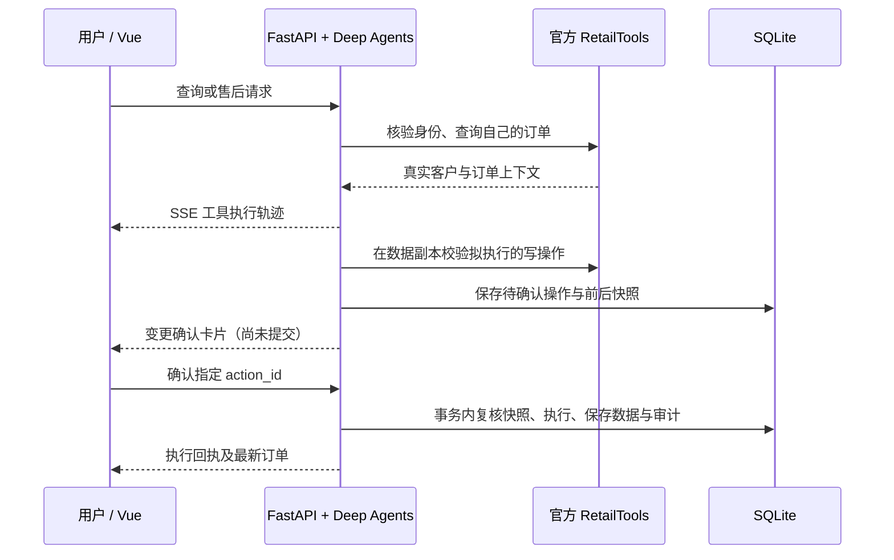

# Retail Desk — Tool-use 智能零售客服

前后端分离的客服框架，范围限定为 **tau2-bench Retail**。客服通过工具查询客户、订单和商品，并能在客户确认后真正改变本地零售数据。

## 技术选型

| 部分 | 选择 | 原因 |
| --- | --- | --- |
| 前端 | Vue 3 / TypeScript / Vite | 组件化聊天、订单上下文、操作确认与工具轨迹 |
| API | Python 3.12 / FastAPI | 与 deepagents、tau2 原生共用 Python 类型和工具，无需 Go/Rust 跨进程桥接；支持 SSE 和 OpenAPI |
| Agent | deepagents / LangChain ChatOpenAI | 使用真实 Deep Agents 执行图；支持 OpenAI 兼容模型服务 |
| 存储 | SQLite / WAL | 本地零配置，持久化业务数据、会话、工具轨迹与审计；写入采用事务 |
| 业务 | 官方 RetailDB + RetailTools + policy.md | 复用 benchmark 状态转换、退款和商品校验，不另造一套业务规则 |

开发时前端 `5173`、API `8000`，通过 Vite 代理请求。构建后可由 FastAPI 在 `8000` 同源提供静态页面，仍保留独立 Vue 源码与 HTTP API。

## 在你的 WSL 中运行

项目位于 `/home/mnyh/projects/retail-agent`，依赖的原始仓库位于同级 `/home/mnyh/projects/tau2-bench`。

```bash
cd /home/mnyh/projects/retail-agent
bash scripts/start.sh
```

打开 **http://localhost:8000**。接口文档：**http://localhost:8000/docs**。

登录页提供演示客户快捷填入。示例账号 `li.ming@retail-demo.example.com`，演示密码 `Demo@Retail2026!`。顶部可切换客服助手、订单管理、个人信息；支持注册独立新账号。详见 [登录与订单管理](docs/accounts-and-orders.md)。

```bash
# 查看或停止本项目后台服务
uv run --frozen python -m backend.server status
uv run --frozen python -m backend.server stop

# 前后端分别热更新（先停止后台服务，避免 8000 端口冲突）
bash scripts/dev.sh
# 浏览器打开 http://localhost:5173
```

WSL 用户目录中已安装 Node.js 22.23.4，脚本自动将它加入 PATH。Python 固定 3.12，因为当前 tau2 导入链使用已在 3.13 删除的 audioop。依赖版本由 `uv.lock`、`frontend/package-lock.json` 固定。

## 两种模式

### 免 Key 演示模式（默认）

`AGENT_MODE=demo` 使用确定性的 `DemoRetailModel`，依然在真实 deepagents 图中调用官方工具。支持身份核验、订单查询、取消 pending 订单、全部商品按原支付方式退货。

登录后场景仅展示当前客户自己的订单，可一键体验。也可以输入：

```text
我的邮箱是 <页面中场景所使用的邮箱>，请查询订单 #Wxxxxxxx。
取消订单 #Wxxxxxxx，原因是不再需要。
订单 #Wxxxxxxx 的全部商品退货，退回原支付方式。
```

演示模型不是通用 LLM，不代表 benchmark 通过率，不支持任意自然语言推理或全部修改工具。页面会明确标识。

### 真实 Agent 模式

`main` 与标签 `v0.1.0-stable` 保存最初稳定演示版本；后续开发在 `dev`，当前优先桌面 Web，手机端功能开发暂停。见 [开发规划](docs/ROADMAP.md)。

DeepSeek 配置模板为 `.env.deepseek.example`。本机已把用户提供的密钥保存到 **WSL 本地 `.env`**，没有上传 GitHub。使用 `MODEL_PROVIDER=deepseek`、`MODEL_NAME=deepseek-flash`、`DEEPSEEK_API_KEY` 和官方地址 `https://api.deepseek.com`；接入层显式关闭思考模式，使用 Chat Completions 完成多轮工具调用。

如需重新配置，可把 `.env.deepseek.example` 的内容复制到 `.env` 后填写密钥。不要覆盖已有本地密钥配置。模型名称应以账户 `/models` 返回值为准。

可在独立临时数据库做真实 DeepSeek 联调（会产生少量模型费用，不改变网页数据库）：

```bash
uv run --frozen python -m scripts.smoke_deepseek --run-live
```

常规 `pytest` 强制使用离线模式，不会因本地 `.env` 切换到 live 而消耗模型 API。

首次配置可执行 `cp .env.example .env`（若已有 `.env`，直接编辑）。

```dotenv
AGENT_MODE=live
MODEL_NAME=你的模型名
MODEL_API_KEY=你的API密钥
# 可选：OpenAI 兼容服务地址，例如 https://your-gateway.example/v1
MODEL_BASE_URL=
```

修改后停止并重新启动后端。模型必须支持 **tool calling**；API Key 仅在后端读取，前端不保存也不接收密钥。真实模型调用会产生服务商费用。

服务实现全部 16 个 Retail 工具；登录网页客户已通过密码核验，Agent 隐藏两个身份查找工具并锁定当前账户。包括：

- 邮箱 / 姓名和邮编核验，客户、订单、商品和规格查询；
- 取消待处理订单，修改订单地址、商品、支付方式；
- 修改客户默认地址，已送达订单退货、换货；
- 金额计算、人工转接记录。

工具数量以 `/api/health` 为准。deepagents 自带的文件与委派工具不会暴露给客服模型，避免偏离零售场景。

## 业务链路



- 网页必须登录，后端绑定当前账户；独立 benchmark / 匿名内部会话仍需邮箱或姓名 + 邮编查找，提供 user_id 不视为核验。
- 单一会话锁定一个客户，订单工具强制检查订单归属。
- 所有七种写工具先在副本上验证。原始数据、支付记录和礼品卡余额在确认前均不变。
- 确认接口消费一次性 action_id，不接受前端重传或替换工具参数；重复提交不重复退款。
- 确认时比较客户和订单快照。若已被其他会话修改，拒绝执行，要求取消后重新请求。
- SQLite 事务内一起保存业务数据、操作审计和待处理状态；不修改原始 tau2-bench 数据文件。
- 每次工具调用和用户确认都进入持久化事件表；刷新、重启后可恢复。
- 同会话请求互斥；启动脚本只运行单个 API worker。

## API

| 方法 | 路径 | 功能 |
| --- | --- | --- |
| GET | `/api/health` | 模式、模型准备状态与工具数量，不返回密钥 |
| POST | `/api/auth/register` | 注册新客户（不能接管已有邮箱） |
| POST | `/api/auth/login`、`/api/auth/logout` | 登录、退出，撤销登录凭证 |
| GET | `/api/me`、`/api/orders` | 当前用户资料、所属订单 |
| POST | `/api/me/address` | 预览默认地址修改 |
| POST | `/api/orders/{id}/actions` | 通过 Retail 工具生成订单变更预览 |
| GET | `/api/samples` | 当前登录客户的订单场景 |
| GET | `/api/sessions` | 当前账户历史咨询 |
| POST | `/api/sessions` | 新建归属于当前账户的会话，不返回敏感 token |
| GET | `/api/sessions/{id}` | 消息、客户、订单、待确认操作和审计事件 |
| POST | `/api/sessions/{id}/messages` | `{ "message": "..." }`，返回 SSE |
| POST | `/api/sessions/{id}/decisions` | `{ "action_id": "...", "approve": true/false }` |

网页接口使用 HttpOnly 登录 cookie，服务端按账号检查会话和订单归属，前端不保存密码或登录 token。SSE 事件为 `status`、`tool_start`、`tool_end`、`done`、`error`，另有 keepalive。当前实时展示工具进度，助手文本在本轮完成后展示。

## 运行官方 Retail 评测

`benchmarks/tau2_agent.py` 提供 `HalfDuplexAgent` 适配器。它每次从 deepagents 获取一个模型动作，交给官方 tau2 orchestrator 执行；不会使用网页数据库或自动点击确认。benchmark 中的修改确认遵循原始用户对话协议。

```bash
# 先在 .env 配置真实模型；需要 Agent 和用户模拟器的模型服务可用
uv run --frozen python -m benchmarks.run_retail --num-tasks 2 \
  --user-model openai/gpt-4.1-mini --save-to deep-retail
```

`--user-model` 是 tau2 / LiteLLM 使用的模型名，和 Agent 的 `MODEL_NAME` 分开配置。若使用不同供应商，为用户模拟器设置对应供应商环境变量；当前脚本会将配置的兼容服务 Key 和地址用于其 OpenAI 用户模拟器默认配置。结果写入 tau2 的 simulations 路径，可用官方 `tau2 view` 查看。

该入口为当前检出版本的 Retail domain 评测，**不是官方 frozen text-v1 leaderboard 提交工作流**。真实模型评测需要 API Key；未配置时脚本会明确停止，不产生虚构分数。

## 测试

最新完整 Retail 评测覆盖 114 条任务、每条 1 次：基线 96/114（84.2%），修正版 98/114（86.0%），净提升 1.75 个百分点。13 条修复、11 条回退，数据库状态匹配均为 101/114；收益有限，保留为 dev 实验版本，没有合入稳定 main。

[完整前后对比、全部失败与原始轨迹](docs/reports/retail-full-20261027.md)。确定性统计、政策校验、无变化项归一化等共 34 项测试通过。

```bash
uv run --frozen python -m benchmarks.run_retail --all --concurrency 3 \
  --max-steps 100 --timeout 600 --seed 42 --save-to /absolute/path/to/new-run
```

2026-10-27 已新增 6 个客户和 18 笔订单，写入网页 SQLite，并完成首轮 5 个官方 Retail 任务：3/5 通过，数据库状态 5/5 匹配。两个失败项为可用商品规格计数错误；这是 DeepSeek 用户模拟器 / 评分器配置下的小样本基线。

- [客户与订单清单](docs/demo-customers.json)
- [逐任务评测与失败分析](docs/reports/retail-baseline-20261027.md)
- 示例邮箱：`li.ming@retail-demo.example.com`，订单：`#W9000001`、`#W9000002`、`#W9000003`。
- `uv run --frozen python -m scripts.seed_demo --apply` 可重复追加演示数据，不会覆盖已有订单变更。

```bash
uv run --frozen pytest -q
uv run --frozen ruff check backend benchmarks tests
uv run --frozen ruff format --check backend benchmarks tests

export PATH="$HOME/.local/opt/node-v22.23.4-linux-x64/bin:$PATH"
cd frontend
npm ci
npm run build
npx playwright install chromium
npm run test:e2e
```

Python 测试均用临时数据库，覆盖身份与越权、七类修改、预览无副作用、确认/拒绝、重复提交、并发修改失效、重启恢复、SSE、真实 ChatOpenAI 兼容接口协议（本地 MockTransport，不产生费用）和 benchmark 适配器。

**浏览器测试使用运行中的本地服务，会确认一笔模拟取消订单，并拒绝一笔退货。** 若希望保持演示库全新，请单独以临时数据库启动测试服务：

```bash
RETAIL_DB_PATH=runtime/e2e.sqlite3 uv run --frozen uvicorn backend.main:app \
  --host 127.0.0.1 --port 8001
# 另一个终端
cd frontend
BASE_URL=http://127.0.0.1:8001 npm run test:e2e
```

## 目录

```text
backend/
  main.py       HTTP / SSE / 会话权限
  agent.py      Deep Agents、真实模型与离线演示模型
  retail.py     官方业务工具桥接、预览和确认提交
  store.py      SQLite 会话、数据与审计
  config.py     环境配置
  server.py     本地后台服务管理
frontend/       Vue 3 聊天与订单工作台
benchmarks/     tau2 Retail 评测适配器和入口
tests/          无真实模型费用的后端集成测试
scripts/        启动及热更新脚本
runtime/        自动生成的数据与日志，不进入 Git
```

## 使用边界

这是可运行、可继续开发的 **本地 benchmark 沙盒框架**。客户、订单和支付记录来自公开合成数据；确认会真实改变本地 SQLite 数据，但不会连接商家、支付或邮件系统。人工转接仅创建本地记录，未接外部工单渠道。

邮箱 / 姓名邮编核验遵循 benchmark 策略，不是生产级账户认证。对公网部署前需要增加正式登录、权限、限流、密钥管理，并将 SQLite 与单 worker 会话互斥改为适合多实例的数据库和任务协调。当前默认仅监听 localhost。

当前使用官方仓库提交 `0c69df4`、tau2 2.0.0；升级上游后应重新运行测试。原始项目采用 MIT 许可，许可证保留在同级原始仓库中。

参考：[tau2-bench](https://github.com/sierra-research/tau2-bench)、[Deep Agents 文档](https://docs.langchain.com/oss/python/deepagents/overview)。
