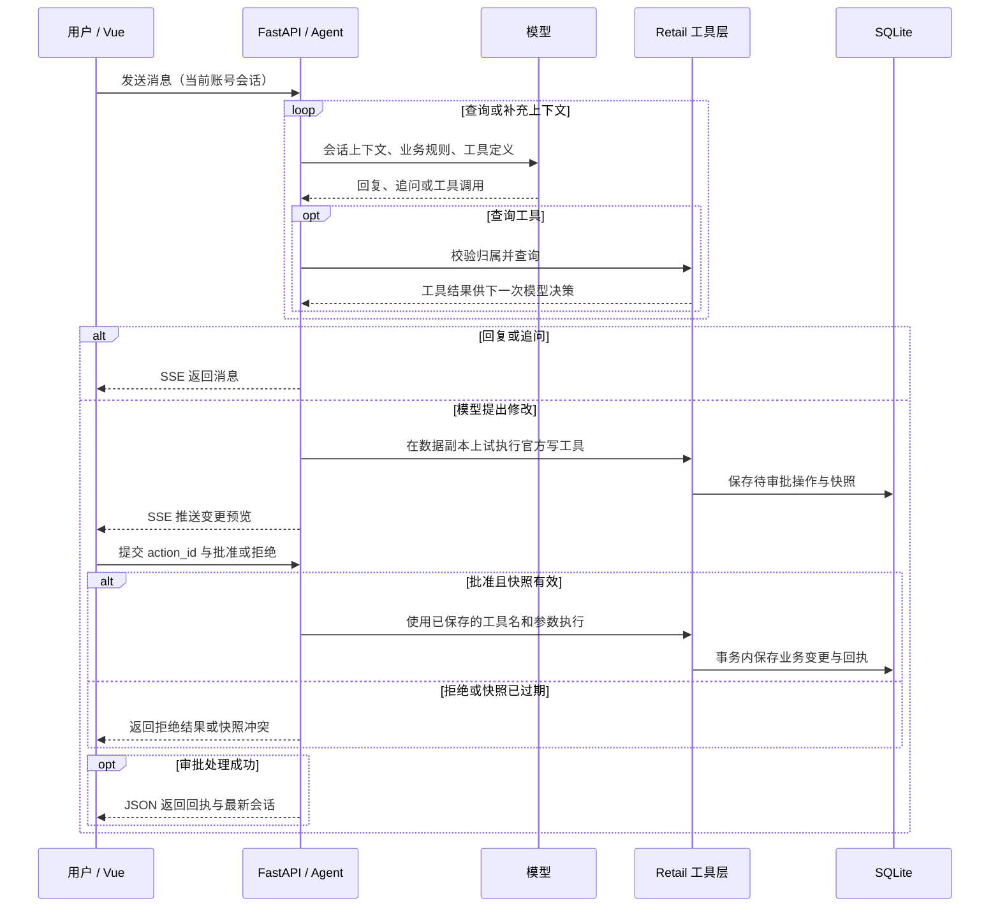

# Retail Desk 后端与 Agent

Vue 3 客户端使用 FastAPI 的会话、订单和审批接口。后端调用模型决定下一步，通过 τ² Retail 工具读取或修改业务数据。SQLite 保存客户、订单、对话、待审批操作和回执；同一账号的聊天与订单页共享业务状态。

## 两种 Agent 执行方式

| 文档名称 | 新浏览器会话配置 | 一轮对话怎样执行 |
| --- | --- | --- |
| **default** | 默认配置，内部值 `b1` | [原生循环](agent.py)读取身份、历史和回执，调用模型。模型可直接回答、追问或请求工具。查询结果回到模型，写操作生成预览后结束本轮。 |
| **LangGraph** | `BROWSER_AGENT_VARIANT=lg_b1` | [StateGraph](graph_agent.py) 用 `load → act → tools → load` 表达相同的工具循环，通过 `finish` 结束本轮。`lg_b1` 适合与 default 对照。 |

两者共用模型接口、权限检查、审批和持久化。模型选择业务步骤，后端强制检查客户身份、订单归属和写入审批。LangGraph 的其他配置可调整工具描述、结构化结果、上下文、售后指引、需求笔记或回复检查，具体开关见[配置表](graph_profiles.py)。`AGENT_MODE` 单独控制使用演示模型还是调用真实模型服务。

## 业务链路



## 工具类型与调用

模型按工具 schema 给出名称和参数。后端从官方 `RetailTools` 加载目录，并在[工具层](retail.py)校验和执行调用。登录会话绑定当前账号，隐藏两个身份查找工具。

| 类型 | 工具 |
| --- | --- |
| 身份查找 | `find_user_id_by_email`、`find_user_id_by_name_zip` |
| 资料与订单查询 | `get_user_details`、`get_order_details` |
| 商品查询 | `list_all_product_types`、`get_product_details`、`get_item_details` |
| 辅助 | `calculate`、`transfer_to_human_agents` |
| 待处理订单变更 | `cancel_pending_order`、`modify_pending_order_address`、`modify_pending_order_items`、`modify_pending_order_payment` |
| 已送达订单售后 | `return_delivered_order_items`、`exchange_delivered_order_items` |
| 客户资料变更 | `modify_user_address` |

例如，用户要修改一笔订单的收货地址，agent 可先用 `get_order_details` 核实订单，再调用 `modify_pending_order_address` 生成预览。用户批准后才更新该订单。更改账户默认地址另用 `modify_user_address`，也需要单独审批。

扩展配置另提供两个只读助手 `find_customer_order_items` 和 `find_product_variants`。`lg_guided` 向模型展示七个 `preview_*` 名称，审批和回执沿用官方工具名。见[工具配置](tool_profiles.py)。

## 前后端 API

登录使用 `retail_auth` HttpOnly cookie，支持 `APP_BASE_PATH`；前端不接收 session token。

| 接口 | 行为 |
| --- | --- |
| POST `/api/auth/register`、`login`、`logout` | 注册、登录、退出 |
| GET `/api/me`、`/api/orders`、`/api/orders/{oid}` | 当前账号资料和订单 |
| POST `/api/me/address`、`/api/orders/{oid}/actions` | 创建待审批操作，返回会话 |
| GET/POST `/api/sessions` | 列出/创建当前账号会话 |
| GET `/api/sessions/{id}` | 消息、上下文、待审批操作和回执 |
| POST `/api/sessions/{id}/messages` | `{message}`，返回 SSE |
| POST `/api/sessions/{id}/decisions` | `{action_id, approve}`，返回 JSON `{receipt, session}` |

浏览器审批后等待下一条用户消息，不自动调用模型。订单页和聊天读取同一账号业务数据。
内部评测的审批接口则会自动续跑并返回 SSE，这两种交互语义不能混同。

## 运行与 TACC

以下命令从仓库根目录执行。前后端联调需要 Node.js、npm 和 uv。Python 3.12–3.13；模型服务须支持 OpenAI-compatible tool calling。
默认从同级 `../tau2-bench` 加载官方数据与代码，源码固定到提交 `0c69df456a96aa76a1162591574dad9c427a34d7`；`TAU2_ROOT` 可覆盖路径。

```bash
uv sync --frozen --python 3.12
test -f .env || cp .env.example .env
(cd frontend && npm ci)
bash scripts/dev.sh
```

启动后在浏览器打开 `http://127.0.0.1:5173`。只运行后端时，用下面的命令代替 `bash scripts/dev.sh`，然后访问 `http://127.0.0.1:8000/docs`。

```bash
uv run uvicorn backend.main:app --host 127.0.0.1 --port 8000
```

要切换到 LangGraph，在根目录 `.env` 设置 `BROWSER_AGENT_VARIANT=lg_b1`，重启后端并新建会话。已有会话保留创建时的配置。

`AGENT_MODE=demo` 使用确定性演示模型；`live` 使用 `MODEL_BASE_URL`、`MODEL_NAME`、`MODEL_API_KEY`。
首次使用 main 登录页的演示账号前，明确设置独立应用 `RETAIL_DB_PATH`，运行：

```bash
uv run python -m scripts.seed_demo --apply
```

初始化脚本在应用 DB 同级保存备份及演示清单，不写入源码目录。
注册新账号只创建空客户，不会继承 tau2 用户数据。

TACC 说明见 [部署概览](../deploy/README.md) 和 [TACC 部署步骤](../deploy/tacc/README.md)。
运行后端需要整个 `backend/`、应用依赖、已安装的 tau2 包以及 Retail db.json/policy.md。
若使用 uv 的本地 editable 依赖，需要完整同级 tau2 源码；仅运行已安装包时可以只提供数据目录。
本分支更新了应用依赖声明，但不代表新版本已在 TACC 完成部署验收。

## 最终 DB 评测

保留 `benchmarks/run_http.py` 与 `benchmarks/reference/` 供 evaluator 调用。
主分比较冻结目标与实际最终 DB：完整客户对象及初始所属订单；列表顺序和重复项保留。
字典键顺序忽略，不根据 agent 实际改动来缩小范围。模型回复“完成”不是评分依据。

- 创建：POST `/internal/eval/episodes`，使用 `EVAL_API_TOKEN`，传 initial_db/customer_id/variant/task_id。
- 交互：GET `/internal/eval/episodes/{id}`，POST `.../messages`、`.../decisions`，使用返回的 episode Bearer token。
- 结束/快照：POST `.../finish`、GET `.../snapshot`，使用 EVAL_API_TOKEN；先冻结再做最终评分。
- 每个 episode 的 DB 独立，目标 DB、参考动作和评分范围不能进入 agent 或模拟用户输入。

当前诊断只测试 default 未通过的 task41、task47：

```bash
python -m benchmarks.run_http run \
  --fixtures /path/to/frozen-fixtures --task-ids 41,47 \
  --output /path/to/new-output --variant lg_sop --seeds 0 \
  --model YOUR_MODEL --thinking off \
  --base-url http://127.0.0.1:8000 --model-base-url http://127.0.0.1:8001/v1
```

只测失败题用于排错，不能当作整体成功率。冻结 fixture 和历史结果放在代码仓库之外。
模型/工具预算默认为每题 80/80 次、600 秒；额外笔记及检查调用同样计入。
