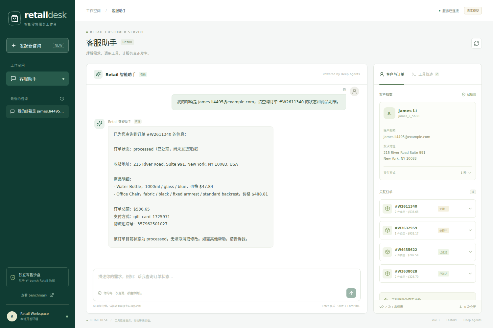

# DeepSeek 接入记录

验收日期：2026-10-27。

接入分支：`dev`。`main` / `v0.1.0-stable` 保留此前的稳定演示快照。

- 服务商：DeepSeek 官方，接口 `https://api.deepseek.com`。
- 账户模型列表已实际验证，当前使用 `deepseek-flash`。
- Chat Completions 模式，显式关闭 thinking，设置 `parallel_tool_calls=false`。
- API Key 从用户指定文件读取，仅保存到 WSL 本地 `.env`（权限 600），未进入 Git、前端或日志。
- 后续工作范围为桌面 Web，手机端功能开发暂停。

## 验证

- 17 项离线集成测试通过；`pytest` 自动强制 demo，不消耗模型 API。
- 真实 DeepSeek 联调在临时数据库中通过：邮箱核验、订单查询、取消预览、确认前数据不变、确认后取消、再次查询得到 cancelled。
- 真实调用工具：`find_user_id_by_email` → `get_order_details` → `cancel_pending_order` → `get_order_details`。
- 临时测试数据库退出后移除，不改变网页使用的 SQLite。
- 桌面浏览器真实链路通过：完成客户核验并显示 4 笔关联订单，页面脚本错误为 0。
- 该联调验证接口和工具链，不等同于完整 tau2 Retail benchmark 分数。

## 本地运行

```bash
cd /home/mnyh/projects/retail-agent
git switch dev
uv run --frozen python -m backend.server stop
bash scripts/start.sh
```

打开 http://localhost:8000，右上角应显示「真实模型」。已有演示会话可以保留，建议新建咨询体验真实模型。

付费联调需显式开启：

```bash
uv run --frozen python -m scripts.smoke_deepseek --run-live
# 桌面浏览器只读查询联调
cd frontend
node e2e/deepseek-live.mjs --run-live
```

浏览器常规演示测试需要另启 `AGENT_MODE=demo` 的服务，并通过 `BASE_URL` 指向它，避免对当前 live 服务运行离线场景测试而产生模型用量。

切回稳定演示版时，本地 `.env` 会继续保留 DeepSeek 配置，需要显式指定 demo：

```bash
uv run --frozen python -m backend.server stop
git switch main
AGENT_MODE=demo bash scripts/start.sh
```

参考：[DeepSeek 首次调用](https://api-docs.deepseek.com/quick_start/agent_integrations/)、[Tool Calls](https://api-docs.deepseek.com/guides/tool_calls/)。


