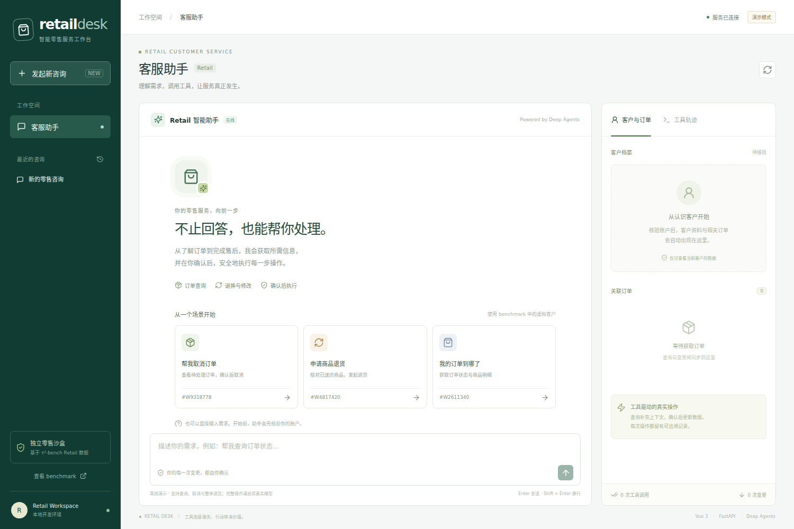

# 验收记录

## 完整 C1/C2 v4 smoke 与可靠性修订（2026-11-18）

huoshan `c1-c2-v4-smoke-20261118T100356Z/` 完整16个episode均有最终快照，协议错误0、未知用量0。同模型Qwen3.5-9B、thinking=off、schema-v2模拟用户、冻结smoke8、seed0与原预算；代码 `dfe9b23`。

| 配置 | DB成功 | 模型/工具调用 | 总tokens（含模拟器） | agent_error |
| --- | --- | --- | --- | --- |
| B1固定对照 | 6/8 | 62/32 | 732,296 | 0 |
| C1 v4 | 3/8 | 70/18 | 674,755 | 3 |
| C2 v4 | 2/8 | 37/12 | 293,886 | 8 |

C1通过10/24/34，失败0/3/16/41/47；C2通过10/24，其余失败。C2的两题虽异常结束但DB正确，按纯DB规则计成功。配对差值C1为-37.5个百分点，bootstrap 95%区间[-75,-12.5]；C2为-50个百分点，区间[-87.5,-12.5]。这是8题功能组，不能外推正式测试集；更少token来自大量早停，不称效率提升。

可复现原因：C1 task0保留ready换货但索要聊天yes，模拟用户将明细说明误作完成并finish；task3重复upsert/supersede同ID；task41在参数中给出与object_id冲突的ID；task16输出tasks后反复空白，4096token截断；task47转人工但target需要退货。C2同样在task16规划截断，其余7题进入检查器后无效任务结算/证据输出触发错误。

修订 `b20b3b8`：显式规划schema与紧凑输出格式、应用绑定对象ID、更新/替代规则；规划截断共享一次修复；C2简化为accept/revise/handoff，不重写答案/复制quote，动态限制信息任务ID；无效检查记录并有界纠正，不终止整个业务会话。研究与GitHub来源、采用边界及测试顺序见PLAN.md修订节。本机29项定向测试通过。`c1-v5-stages-20261118T122309Z` 两个planner与七个reviewer格式通过，但自由反馈仍有事实错误，故进一步改为固定issue枚举（review v4）。`c2-v4-review-stages-20261118T122732Z` 七个真实检查复测全部格式通过，输出15–21tokens，人工复核没有再生成商品/聊天确认建议；这不保证问题分类无误。

最终代码 `86694a9` 在 huoshan `c1-v5-final-software-20261118T122732Z` 完整 **146 passed**（63.83s）。新批次 `c1-c2-v5-smoke-20261118T122924Z` 已冻结该源码，先C2后C1各smoke8，自动与B1及同variant旧v4比较。模型服务、权重、模拟用户、target、工具及预算未变，当前尚无完整新分数。

## C1/C2 agent 实施与开发验证（2026-11-18）

B1固定在本地标签 `baseline/b1-http-v1@03ac358`。新增C1显式任务规划、按观察展开多订单范围、真实回执结算、参数/依赖校验；新增C2回复前完成检查和一次有界纠正。额外planner/reviewer/repair调用均计入原预算；私有agent_state保留任务、原始规划和未发送的纠正草稿，普通用户及模拟器不读取这些内部记录。

主要受测版本：`785349a`初版C1，`7740f28`消息ID证据，`f256321`初版C2，`6aa2d70`类型化参数与对象ID约束，`5a928fe`在唯一纠正调用上使用named tool_choice生成下一张预览并拦截相同参数失败重试。未改变16业务工具及后端审批授权规则。

软件证据：huoshan `c1-software-20261118T083119Z/` 128 passed；`c1-typed-scope-20261118T084347Z/` 131 passed；`c2-four-operations-20261118T085948Z/` 138 passed；`c1-v3-integration-20261118T091516Z/` 139 passed。最后增加的blocked/原生参数恢复/named tool_choice小测试与前端构建通过；最终完整验证另追加。

真实合成案例要求：账户地址＋两个订单地址＋随后取消指定订单，共四次审批。脚本只批准与明示需求完全一致且顺序合法的卡片；此为 `scripted_live_agent_contract` 集成检查，**不是benchmark成绩**。早期quote复制和scope混淆失败均在写入前拦截，历史目录保留。消息ID版本C1一次规划四项，执行三个地址修改，取消仍停在聊天yes；C2初版的一次运行完成四项且DB匹配，但后续v3复测再次出现纠正后仍索要聊天yes，因此加入有界named tool_choice纠正，并继续复测，不能以先前单次通过代替当前版本验收。

`c1-c2-smoke-20261118T090536Z/` 是已中止的开发批次：前两题在规划时出现未知业务参数名、商品ID误作订单ID，随后封存会话并标记superseded；没有完整suite成绩。规划器v3使用直接字符串/数组值，按用户已观察数据限制对象ID、按官方工具参数限制字段名。`c1-v3-planner-check-20261118T091218Z/live-cases/` 对上述两题的公开初始请求，真实9B规划一次通过，未使用target或参考动作。

当前冻结版本 `5a928fe` 在 huoshan `c2-native-choice-20261118T092200Z/` 完整 **142 passed**（65.62s），Ruff通过；真实四操作案例最终DB匹配，四项均有executed回执，共1次planner、5次executor、1次reviewer，输入75,249/输出2,900 tokens，174.39s。该次运行未触发纠正分支；另在 `c2-native-tool-choice-protocol-20261118T092804Z/` 验证真实服务支持指定原生工具且参数正确，合成SDK/状态测试验证纠正分支和审批前DB不变，不能将协议验证当作benchmark提升。

开发批次 `c1-c2-v3-smoke-20261118T092829Z/` 已因同对象任务替换错误中止并标记 `superseded_task_replacement_bug`，不是完整成绩。其源码与模型记录保留。`a341b50` 修复先合并再废弃导致新需求消失的问题，并保持替代任务的依赖；`dfe9b23` 保留模型截断响应及 SDK 已返回的实际 token 用量。

最新代码 `dfe9b23` 在 huoshan `c1-c2-replacement-regression-20261118T094550Z/` 完整 **145 passed**（67.05s）。此前 `094517Z` 启动误用了未安装 tau2 的 Python，未进入测试；随后使用独立 app 环境重跑。`c1-v4-replacement-20261118T100234Z/` 真实9B两轮规划复测通过：仅输入公开对话、初始客户上下文、实际商品查询结果及首轮任务，用户补充两件替换商品和信用卡后保持唯一有效换货任务，保留正确参数。此为公开输入规划验证，不是benchmark成绩。

冻结代码 `dfe9b23` 的新批次为 `c1-c2-v4-smoke-20261118T100356Z/`，使用已重启的同版应用、同一9B服务、schema-v2模拟器和原smoke8目标，顺序运行C1/C2。该批次现已完整结束；源码、权重摘要及B1对照路径记录在 `source-attestation.json`。

该批完整结果见文档开头，C1/C2均低于B1；原始数据、冻结目标和比较器保持现行版本。

## 最新结果：schema v2 模拟器完整重测

远程批次 `schema-v2-paired-smoke-20261118T065355Z/` 已完整结束。B1 与 enhanced 各跑 smoke8 × seed0，共 16 个有效最终快照，**模拟器协议错误 0、未知 token 用量 0**。采用同一 Qwen3.5-9B BF16、thinking=off、600秒预算、冻结目标与比较器；agent/guide 未改，evaluator 使用 `visible-action-schema-v2`（源码提交 `40e1af6` 对应文件摘要）。原始目标和旧批次均保留。

| 指标 | B1 | enhanced |
| --- | --- | --- |
| DB 成功率 | 6/8（75%） | 6/8（75%） |
| 模型调用 / 工具请求 | 62 / 32 | 46 / 27 |
| agent tokens | 622,439 | 486,068 |
| simulator tokens | 109,857 | 75,231 |
| 完整总 tokens | 732,296 | 561,299 |
| 每成功 episode 总 tokens | 122,049.3 | 93,549.8 |
| episode p50 / p95 秒 | 132.4 / 256.6 | 109.9 / 150.8 |
| 正常用户结束 / 转人工 | 6 / 2 | 7 / 1 |

成功率差 0 个百分点，配对 bootstrap 95% 区间 [-37.5,+37.5] 个百分点；8 个任务不足以得出正式成功率提升。增强完整总 token 减少约 23.4%，agent token 减少约 21.9%；不能把早期退出导致的成本降低直接解释为能力提升。B1 仍为默认。

B1 失败 task41（两个订单地址未更新）与 task47（未提交退货）。增强失败 task16 与 task41：

- task16 的所有业务请求均执行，唯一 DB 差异是退货退款方式为 gift card，目标要求 PayPal；原用户场景未指定方式，见评测对齐文档。本轮严格计失败，不事后修改 target。
- task41 的两处订单地址未落库，模拟器在仍有待审批卡片时以“已完成”为由结束，混淆了预览与实际回执；另有信用卡与目标 PayPal 的差异。说明 schema 保证动作格式，但不保证用户对完成状态的判断。

下一阶段须冻结目标欠明确的处理口径，并验证模拟器对 pending/executed 的理解，再做正式开发54/验证20消融。原始 trace、快照和配对报告位于上述远程目录；本机轻量证据在 `runtime/evidence/schema-v2/paired/`。本轮没有运行 27B 或 test40。

## 2026-11-17：Retail HTTP DB 改造

本轮本机负责实现、静态检查及小 case；完整后端测试、浏览器验证、参考目标重放及服务运行在 **huoshan**。下面的 UTC run 名称为 2026-11-18，对应 America/Chicago 的 2026-11-17。软件验证与真实模型评测分别记录。

源码基于 `deploy/tacc@a3173371079b53779a933e50ed79d528b7843a96`，开发分支 `feat/retail-agent-eval`；tau2 固定 `0c69df456a96aa76a1162591574dad9c427a34d7`。已实现独立 episode DB、B1 原生工具循环、三项可切换增强、决策后续跑 SSE、私有评测接口与最终 DB 参考评测。当前 guide 是政策种子，不是学习得到的改进。

| 实际检查 | 位置 / 规模 | 结果 |
| --- | --- | --- |
| 上游干净快照 pytest | huoshan，原有完整套件 | 18 passed |
| 当前改造后的 pytest | huoshan，完整套件 | 119 passed，55.98s |
| Ruff lint / format | huoshan lint、本机格式检查 | 通过 |
| Vue TypeScript / Vite 构建 | 本机及 huoshan | 通过 |
| Playwright | huoshan，桌面批准/刷新/隔离及移动端拒绝/刷新 | 2 passed，10.6s |
| 确定性 HTTP 闭环 | huoshan，取消批准、退货拒绝 | 2 项通过，最后快照再次通过 |
| 参考动作审计 | huoshan，全 114 题 | 18 个预期失败动作均未改变 DB |
| 冻结目标生成 | huoshan，development54 / validation20 / test40；另 smoke8 | 全部有完成标记 |

首轮真实模型组：Qwen3.5-9B BF16，`thinking=off`，16 工具，seed0，每题 600 秒，单次模型请求 300 秒。B1 完整结果为 **6/8（75%）**：6 次 simulator_finish、1 次转人工、1 次模拟器/协议错误；所有 8 题有有效 DB 快照，agent usage 无缺失。错误结束仍按纯 DB 口径评分，不冒称正常完成。

B1 的 task41 遗漏两个订单地址（账户地址已更新）；task47 未提交要求的退货，停留在退款时效争论。B1 共 61 次模型调用、31 次工具调用，输入 599,746 / 输出 14,385 tokens；一次模拟器响应 usage 未知，因此含模拟器的总成本保持 null，不用观测小计代替完整成本。这是开发 smoke，不能代替 test40 或 pass^3。

### 首轮 9B 功能比较（旧模拟器，保留历史）

相同固定模型服务、公开输入、16 工具、政策、比较范围与预算；所有 16 个 episode 都有有效冻结快照。B1 源码为 `de09a34` 对应的受测摘要，增强为 `d6f32cf`；五个公共执行文件（retail/store/main/config/provenance）字节摘要一致，agent 与指南差异有源码和 manifest 记录。两边完整 completion markers 与 evaluator 源码哈希已由 compare 检查。

| 指标（smoke8 × seed0） | B1 | enhanced v2 |
| --- | --- | --- |
| 严格最终 DB 匹配 | 6/8（75%） | 6/8（75%） |
| agent 模型调用 | 61 | 46 |
| agent 工具请求 | 31 | 27 |
| agent 输入 tokens | 599,746 | 467,597 |
| agent 输出 tokens | 14,385 | 11,098 |
| episode p50 / p95（秒） | 126.4 / 259.2 | 103.3 / 155.6 |
| 模拟器/协议错误结束 | 1 | 1 |
| simulator_finish / 转人工 | 6 / 1 | 6 / 1 |

成功率差为 **0 个百分点**，任务聚类 bootstrap 95% 区间 **[-37.5,+37.5] 个百分点**（8 对 episode，10,000 bootstrap，seed0）。增强组 agent token 合计从 614,131 降到 478,695，约减少 22.1%，调用减少 24.6%；这是同一开发 smoke 的观察，不能据此推断正式 test40 的提升，也没有单模块消融归因。两组各有一个模拟器 step 未记录 usage，含模拟器的完整总成本及每成功成本保持 null。

两组结果互有变化：B1 失败 task41、task47；增强失败 task16、task41。增强完成了原先未提交的 task47 退货；task16 由模拟器/协议错误终止。增强 task41 只剩一个订单地址未提交，但另出现参考 PayPal 与用户批准信用卡的字段差异。原始用户场景未限定该支付选择，详见 [正式评测对齐事项](EVAL_ALIGNMENT.md)。v1 目标/范围没有事后更改，两个失败仍保留。

保持 **B1 为默认**。现有增强作为实验配置保留；未证明成功率提升。下一步先对齐目标欠明确与模拟器协议问题，再接入并核验实际 27B，运行开发54/验证20的单模块与组合比较，最后冻结 test40×3。自动“成功声明事实性”指标尚未实现，当前仅人工核查轨迹；不把人工观察冒充自动评分。

关键远程证据（均位于 `/vePFS/han/retail-desk/runs/`）：

- `live-smoke8-enhanced-v2-20261118T042543Z/`：最终 114 项完整测试、Ruff、增强完整 smoke8、分析和配对报告；受测源码 `d6f32cf`，guide v2 SHA256 `c497db81d73be7c839931c7ea913c9db6d07ccc0cf2084caf25e0dbba4ae7077`。
- `live-smoke8-enhanced-receipts-20261118T041513Z/`：中间回执投影版本的软件验证与不完整诊断，不混入完整比较。
- `live-smoke8-b1-off-retest-20261118T034903Z/`：B1 完整 smoke8、结果/分析/源码对应证明。
- `software-20261118T024844Z-a317337-599076/`：早期 107 项测试、静态检查及三组完整目标。
- `final-focus-20261118T025435Z-a317337-610915/`：最后 handoff 定向测试、demo HTTP、smoke8 目标、实际源码摘要。
- `software-20261118T023129Z-a317337-543062/`：Playwright 日志与浏览器产物。该目录的早期 development/test 目标生成失败，后续完整目标使用上面的新目录；历史失败保留。
- `reference-audit-20261118T024107Z-a317337-579751/audit.json`：两个无状态变化的 WRITE 异常的精确审计，原任务、分母、数据未修改；规则见 [评测协议](EVAL_PROTOCOL.md)。

早期业务快照（025435Z）的 56 文件 canonical SHA256 为 `1f7fba2c1da79394c5f9b711f3dd6a8e7e41fcc3f3c7de49ff5c263b4aa3646e`。轻量日志、完成标记和源码摘要复制到本机 `runtime/evidence/`（Git 忽略），完整 episode/目标保存在远端；文件摘要可将提交后的源码与实际执行快照对应。

推理环境为独立 Python 3.12、vLLM 0.17.1、torch 2.10.0+cu128。Qwen3.5-9B 四个实际权重分片与现有 HF metadata SHA256 一致。GPU1 的 BF16 128×128 matmul 已通过，证据 `cuda-runtime-20261118T030924Z/`；仅本任务进程使用既有 CUDA compatibility 库，未修改系统驱动或停止既有 GPU 任务。

真实模型协议通过；B1 与冻结增强 v2 的完整 smoke8 均为 6/8，配对差值为 0。**上述 demo、MockTransport、pytest 与目标重放均不是模型成功率。** 尚未运行 27B development/validation 或 test40×3，不能声称最终 agent 成功率提升。真实 TTFT/ITL 未采集，当前仅报告 HTTP turn/episode 时间与已知 token 使用量。

### 真实 9B 接口修复与重测

CUDA、默认 thinking/4096 输出预算下的文本、16 工具 schema 调用、JSON 约束及最小 Simulator.step 均已通过。首轮 B1 smoke8 的八题全部在业务工具调用前报 `System message must be at the beginning`；原始 DB 匹配为 2/8，但只来自无写入题，不能解读成 B1 能力。失败批次完整保存在 `live-smoke8-b1-20261118T032239Z/`。

修复将 policy、客户上下文、状态及带对话位置的可信应用回执合并到唯一首条 SystemMessage，原始持久历史和应用回执语义保留。SDK 传输测试检查每次请求的角色序列及批准后的回执续跑。修复快照 `20261118T033737Z-9f0656d-689428` 在 huoshan **108 passed**（43.77s）、Ruff 通过，证据 `prompt-layout-20261118T033753Z/`；本机另通过包含决策后续跑的 SDK 传输定向测试。

中间 live app 为 `app-20261118T033854Z-7c34b7`；其 `live-smoke8-b1-layout-20261118T033907Z/` 批次因下述超时问题中止，不能称完整 smoke8。

### 9B thinking 续跑诊断

`tool-continuation-20261118T034431Z/` 保存了实际工具结果续跑请求及服务原始响应：模型把第二个工具 XML 放在 `reasoning`，`content=null`、`tool_calls=[]`。同一公开上下文和工具输入，仅显式设置 `enable_thinking=false`，在 `tool-continuation-nonthinking-20261118T034535Z/` 得到正确原生 `get_product_details` 调用。后端不从隐藏 reasoning 提取或执行工具。

布局修复批次 `live-smoke8-b1-layout-20261118T033907Z/` 的 task0 最终由 `OpenAITimeoutError` 截断，4 次 agent 调用中 1 次 usage 未知；确认 60 秒模型 HTTP 超时不适合当前解码速度后停止该批，保留已完成的题及不完整标记。它不是完整 smoke8 结论。

后续统一单次模型请求超时为 300 秒、finish drain 为 310 秒（evaluator HTTP 315 秒），600 秒 episode 预算不变；冻结 DB 先于等待完成，等待期间不能执行新写入。新增 `MODEL_THINKING` 和 evaluator `--thinking`，检查 agent/simulator 模式一致，manifest 与比较器拒绝不同设置混组。9B 功能验收改用独立 `thinking=off` 组，不合并先前 auto 组。

模型名称另经[官方 Qwen3.8-27B 模型页](https://huggingface.co/Qwen/Qwen3.8-27B)核实存在；TACC 脚本声明的 AWQ-INT4 实际权重、版本与服务仍未验收。

最新非思考组软件验收：`live-smoke8-b1-off-retest-20261118T034903Z/pytest.log` 为 **110 passed**（45.78s），Ruff 通过。受测 release `20261118T034845Z-cfacb74-708313` 的 43 个 backend/benchmarks/tests/deploy 文件与本地提交 `de09a34` 逐个 SHA256 一致，远程 `implementation-attestation.json` 及本机 `runtime/evidence/qwen-live/tested-source.json` 保留对应关系。该目录运行 B1 的 smoke8；同模型、配置与冻结题目的 enhanced 功能组排在 `queued-enhanced-smoke-20261118T035628Z/`。完成标记与最终报告出现前，不将部分结果写成整组成绩。

初始 enhanced 功能批次在完成前两题后，同样观察到真实执行后仍重复等待确认；该批随后被标记 superseded，保留为不完整诊断，不能与完整 B1 作成功率对比。状态增强增加按 action ID 的回执观察投影：模型看到已执行/已拒绝的真实结果，并移除对应暂停提示；原始历史、工具调用关联与业务审计保留，B1 输入行为不变。本机 26 项 agent/SDK 定向测试通过，覆盖批准/拒绝、原始历史保留及状态开关；后续新批次单独记录。

增强的回执投影首题已验证正确解释 executed，但随后发现另一个通用 UI 语义问题：模型反复要求聊天 yes 而不生成卡片。该中间批次 `live-smoke8-enhanced-receipts-20261118T041513Z/` 亦作为不完整诊断保留。静态 seed guide 升级到 v2，明确需求参数齐全即可生成无副作用预览、卡片才授权执行，以及先回答审批所需信息、继续未完成需求、不支持的要求转人工。内容来自公开政策和应用契约的集成澄清，不包含 target、参考动作、任务 ID 或特定题目答案，不称为自动学习指南；新的完整功能批次冻结此版本。

### 模拟器 schema v2 验收（后续批次）

针对真实 smoke 中的非法模拟器动作，加入 `visible-action-schema-v2`：动态约束页面允许动作、固定当前卡片 ID，同时保留批准/拒绝两种模型选择；无效响应原文、错误和已知 usage 持久化。比较器拒绝与旧模拟器版本配对。

huoshan `simulator-schema-v2-20261118T065020Z/` 完整 **119 passed**（55.98s）、Ruff 通过。首轮三项真实模型检查发现消息仅生成单字符：JSON Schema 非空正则在当前约束解码器被按整串处理。已改为允许完整多行字符串的显式模式，并在 `simulator-schema-content-20261118T065241Z/` 重新验证：完整取消请求（包含取消意图与订单号）、批准正确卡片、拒绝错误卡片均通过；同目录 62 项 evaluator 定向测试通过。早期单字符响应保留，不称其为有效内容验收。

新评测批次 `schema-v2-paired-smoke-20261118T065355Z/` 按 B1、enhanced 顺序完整重跑 smoke8；两边使用同一新模拟器。`source-attestation.json` 证明本次运行的 agent/状态/业务/存储/API/config/guide 与当前代码相同，只有 evaluator 修订。现已完成，最终结果见文档开头；不与旧版 6/8 混合。

## 历史记录：2026-10-26

日期：2026-10-26。环境：WSL Ubuntu 24.04、Python 3.12、Node.js 22.23.4。

## 已通过

| 检查 | 结果 |
| --- | --- |
| Python 集成测试 | 16 passed |
| Ruff lint / format | 通过 |
| Vue TypeScript 与 Vite 生产构建 | 通过 |
| 浏览器：取消预览、确认、状态更新、刷新恢复 | 通过 |
| 浏览器：390px 手机布局、退货拒绝、页面无横向溢出 | 通过 |
| 浏览器脚本错误 | 0 |
| Windows → WSL HTTP 访问 | `/api/health` 返回 200 |
| 原始 tau2-bench 仓库 | 工作区干净 |

后端集成覆盖：身份前置校验、跨客户订单访问拒绝、会话客户锁定、七类写操作、预览无副作用、确认与拒绝、重复确认、快照过期、数据恢复、会话 token 隔离、SSE、人工转接、金额计算、Deep Agents 对话记忆。

真实 ChatOpenAI 传输路径使用 `httpx.MockTransport` 验证工具 schema 和参数、单次工具调用与写预览后的强制停止；没有向外部模型发送请求。benchmark adapter 测试验证调用交给 tau2 环境执行，且不修改网页数据库。

## 外部条件

未配置真实模型 API Key，因此没有运行付费模型对话或真实 tau2 Retail 打分，**没有可报告的通过率**。真实模式的完整自然语言任务能力取决于所配置模型；离线演示模式仅覆盖 README 中列出的场景。

浏览器测试使用的是合成 Retail 沙盒数据，已确认的取消只改变项目自己的 SQLite 文件。官方 seed 文件、真实支付、邮件和商家系统均未改动。

## 界面截图

