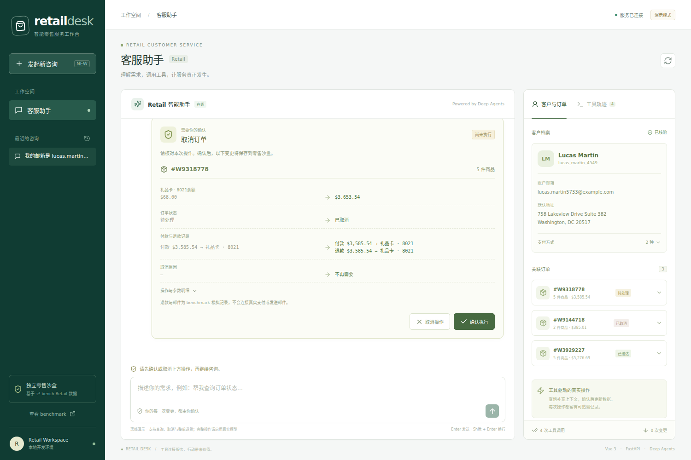
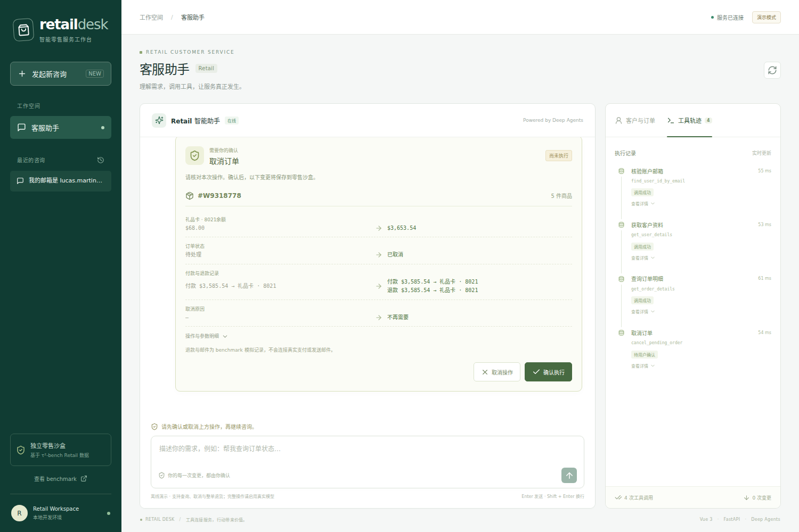
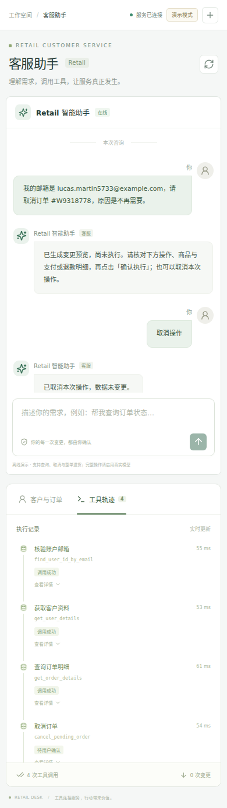

# 验收记录

## 2026-11-17：Retail HTTP DB 改造

本轮本机负责实现、静态检查及小 case；完整后端测试、浏览器验证、参考目标重放及服务运行在 **huoshan**。下面的 UTC run 名称为 2026-11-18，对应 America/Chicago 的 2026-11-17。软件验证与真实模型评测分别记录。

源码基于 `deploy/tacc@a3173371079b53779a933e50ed79d528b7843a96`，开发分支 `feat/retail-agent-eval`；tau2 固定 `0c69df456a96aa76a1162591574dad9c427a34d7`。已实现独立 episode DB、B1 原生工具循环、三项可切换增强、决策后续跑 SSE、私有评测接口与最终 DB 参考评测。当前 guide 是政策种子，不是学习得到的改进。

| 实际检查 | 位置 / 规模 | 结果 |
| --- | --- | --- |
| 上游干净快照 pytest | huoshan，原有完整套件 | 18 passed |
| 改造后的 pytest | huoshan，完整套件 | 107 passed，44.26s |
| 最后 handoff 修复 | huoshan，2 项定向测试 | 2 passed，2.83s |
| Ruff lint / format | huoshan，39 个 Python 文件 | 通过 |
| Vue TypeScript / Vite 构建 | 本机及 huoshan | 通过 |
| Playwright | huoshan，桌面批准/刷新/隔离及移动端拒绝/刷新 | 2 passed，10.6s |
| 确定性 HTTP 闭环 | huoshan，取消批准、退货拒绝 | 2 项通过，最后快照再次通过 |
| 参考动作审计 | huoshan，全 114 题 | 18 个预期失败动作均未改变 DB |
| 冻结目标生成 | huoshan，development54 / validation20 / test40；另 smoke8 | 全部有完成标记 |

关键远程证据（均位于 `/vePFS/han/retail-desk/runs/`）：

- `software-20261118T024844Z-a317337-599076/`：107 项测试、静态检查及三组完整目标。
- `final-focus-20261118T025435Z-a317337-610915/`：最后 handoff 定向测试、demo HTTP、smoke8 目标、实际源码摘要。
- `software-20261118T023129Z-a317337-543062/`：Playwright 日志与浏览器产物。该目录的早期 development/test 目标生成失败，后续完整目标使用上面的新目录；历史失败保留。
- `reference-audit-20261118T024107Z-a317337-579751/audit.json`：两个无状态变化的 WRITE 异常的精确审计，原任务、分母、数据未修改；规则见 [评测协议](EVAL_PROTOCOL.md)。

最后业务快照的 56 文件 canonical SHA256 为 `1f7fba2c1da79394c5f9b711f3dd6a8e7e41fcc3f3c7de49ff5c263b4aa3646e`。轻量日志、完成标记和源码摘要复制到本机 `runtime/evidence/`（Git 忽略），完整 episode/目标保存在远端；文件摘要可将提交后的源码与实际执行快照对应。

推理环境为独立 Python 3.12、vLLM 0.17.1、torch 2.10.0+cu128。Qwen3.5-9B 四个实际权重分片与现有 HF metadata SHA256 一致。GPU1 的 BF16 128×128 matmul 已通过，证据 `cuda-runtime-20261118T030924Z/`；仅本任务进程使用既有 CUDA compatibility 库，未修改系统驱动或停止既有 GPU 任务。

真实模型协议和 smoke8 结果待追加。**上述 demo、MockTransport、pytest 与目标重放均不是模型成功率。** 尚未运行 27B development/validation 或 test40×3，不能声称 agent 提升。真实 TTFT/ITL 未采集，当前仅报告 HTTP turn/episode 时间与已知 token 使用量。

## 历史记录：2026-10-26

日期：2026-10-26。环境：WSL Ubuntu 24.04、Python 3.12、Node.js 22.23.4。

## 已通过

| 检查 | 结果 |
| --- | --- |
| Python 集成测试 | 16 passed |
| Ruff lint / format | 通过 |
| Vue TypeScript 与 Vite 生产构建 | 通过 |
| 浏览器：取消预览、确认、状态更新、刷新恢复 | 通过 |
| 浏览器：390px 手机布局、退货拒绝、页面无横向溢出 | 通过 |
| 浏览器脚本错误 | 0 |
| Windows → WSL HTTP 访问 | `/api/health` 返回 200 |
| 原始 tau2-bench 仓库 | 工作区干净 |

后端集成覆盖：身份前置校验、跨客户订单访问拒绝、会话客户锁定、七类写操作、预览无副作用、确认与拒绝、重复确认、快照过期、数据恢复、会话 token 隔离、SSE、人工转接、金额计算、Deep Agents 对话记忆。

真实 ChatOpenAI 传输路径使用 `httpx.MockTransport` 验证工具 schema 和参数、单次工具调用与写预览后的强制停止；没有向外部模型发送请求。benchmark adapter 测试验证调用交给 tau2 环境执行，且不修改网页数据库。

## 外部条件

未配置真实模型 API Key，因此没有运行付费模型对话或真实 tau2 Retail 打分，**没有可报告的通过率**。真实模式的完整自然语言任务能力取决于所配置模型；离线演示模式仅覆盖 README 中列出的场景。

浏览器测试使用的是合成 Retail 沙盒数据，已确认的取消只改变项目自己的 SQLite 文件。官方 seed 文件、真实支付、邮件和商家系统均未改动。

## 界面截图

