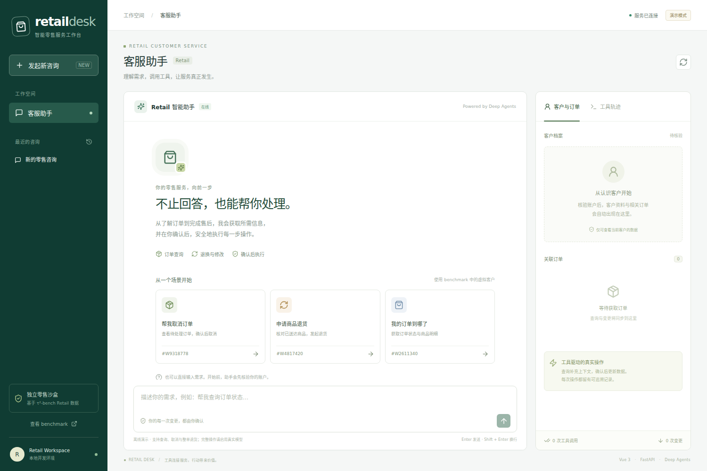
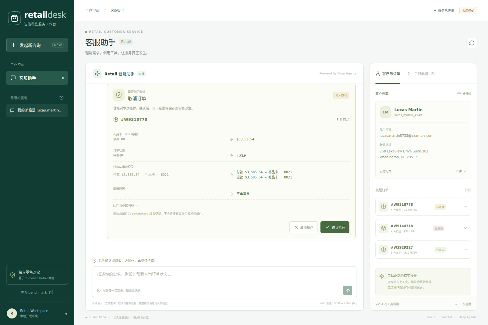
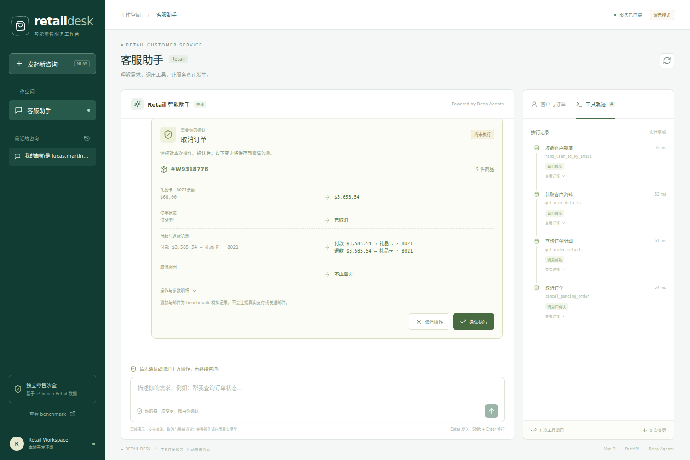
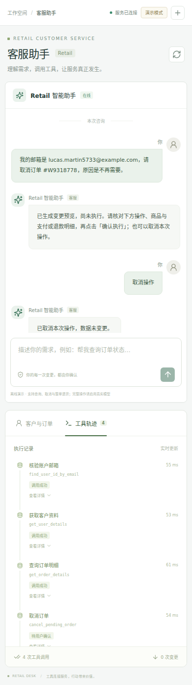

# 验收记录

日期：2026-10-26。环境：WSL Ubuntu 24.04、Python 3.12、Node.js 22.23.4。

## 已通过

| 检查 | 结果 |
| --- | --- |
| Python 集成测试 | 16 passed |
| Ruff lint / format | 通过 |
| Vue TypeScript 与 Vite 生产构建 | 通过 |
| 浏览器：取消预览、确认、状态更新、刷新恢复 | 通过 |
| 浏览器：390px 手机布局、退货拒绝、页面无横向溢出 | 通过 |
| 浏览器脚本错误 | 0 |
| Windows → WSL HTTP 访问 | `/api/health` 返回 200 |
| 原始 tau2-bench 仓库 | 工作区干净 |

后端集成覆盖：身份前置校验、跨客户订单访问拒绝、会话客户锁定、七类写操作、预览无副作用、确认与拒绝、重复确认、快照过期、数据恢复、会话 token 隔离、SSE、人工转接、金额计算、Deep Agents 对话记忆。

真实 ChatOpenAI 传输路径使用 `httpx.MockTransport` 验证工具 schema 和参数、单次工具调用与写预览后的强制停止；没有向外部模型发送请求。benchmark adapter 测试验证调用交给 tau2 环境执行，且不修改网页数据库。

## 外部条件

未配置真实模型 API Key，因此没有运行付费模型对话或真实 tau2 Retail 打分，**没有可报告的通过率**。真实模式的完整自然语言任务能力取决于所配置模型；离线演示模式仅覆盖 README 中列出的场景。

浏览器测试使用的是合成 Retail 沙盒数据，已确认的取消只改变项目自己的 SQLite 文件。官方 seed 文件、真实支付、邮件和商家系统均未改动。

## 界面截图

