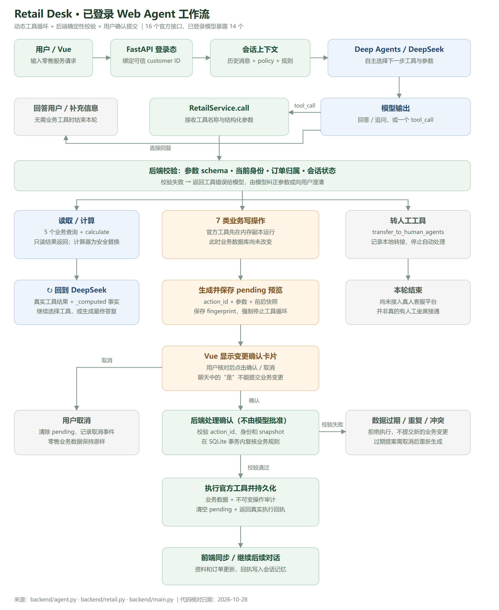

## 9. Tool-use 的官方来源与本项目实现边界

补充核对日期：2026-10-28。

**不是整套 Agent 都由官方写好。16 个工具的名称、参数定义和大部分零售业务函数来自官方 tau2-bench；工具选择、上下文组织、网页交互、安全边界与持久化由本项目实现。**

| 层次 | 来源 | 本项目怎样使用 |
| --- | --- | --- |
| 业务数据、政策、工具 schema | 官方 RetailDB、policy.md、RetailTools | 复用，加载到本项目沙盒 |
| 零售业务函数 | 官方 RetailTools | 查询直接读取；七种写操作先在副本校验，确认时才执行并持久化 |
| calculate 的函数名和参数 | 官方接口 | 网页执行实现改成受限 AST 四则运算，不使用官方 eval 实现 |
| Agent 执行框架 | Deep Agents / LangChain | 用框架搭建本项目的客服 Agent，不是官方默认 Agent 原样运行 |
| 下一步工具与参数选择 | DeepSeek + 本项目提示和观察结果 | 动态决策，不是固定的“先工具 A、再工具 B”的脚本 |
| 账号、归属校验、确认、审计 | 本项目 | 由后端确定性执行，模型不能跳过 |
| 前端、API、SQLite、部署 | 本项目 | Vue / FastAPI / SQLite / VPS |
| Benchmark 接入 | 本项目 HalfDuplexAgent 适配器 | 把模型选出的调用交给官方 runner 执行，评测数据库与网页隔离 |

官方工具按类型为 **7 READ + 7 WRITE + 2 GENERIC = 16**。网页登录后隐藏两个身份查找工具，模型当前可见 **5 READ + 7 WRITE + 2 GENERIC = 14**。健康接口的 16 是完整目录数量，不是每个登录会话的可见数量。

### 9.1 当前网页 Agent 的工作流



图的关键点：模型可以多次查询、计算和补充上下文，但每次只放行一个业务工具调用；工具结果和错误再反馈给模型。出现待确认写操作或人工转接时，中间件强制终止这一轮工具循环。

查询结果里的 `_computed` 是从实际工具返回中确定性算出的库存数量、价格等事实，不是额外工具，也不是任务标准答案。

用户点击订单页或资料页的管理按钮时，可以直接调用后端生成预览，**不需要先让模型决定一次工具**；之后的确认提交、权限校验和审计与聊天完全共用。

### 9.2 Web 与 Benchmark 是两条执行路径

- **网页**：模型 → RetailService → 副本预览 → 用户点击确认 → 后端事务提交；使用账号身份和本项目 SQLite。
- **Benchmark**：模型 → 本项目适配器输出 tool_call → 官方 runner 执行 → 官方工具结果返回模型；按政策在对话中取得用户模拟器的明确确认，不使用网页按钮，也不写网页数据库。
- 因此“Benchmark 没改官方工具”与“网页包装了安全确认流程”并不矛盾。

## 10. 全部 16 个工具：用途、参数和执行效果

下列签名省略 Python 的 `self`。订单 ID 通常带 `#W` 前缀；`product_id` 是商品类型，`item_id` 是具体规格，不能混用。`payment_method_id` 是支付方式标识，不是银行卡号或尾号。

地址参数统一为：`address1` 街道、`address2` 第二行（可空字符串）、`city` 城市、`state` 州/省、`country` 国家、`zip` 邮编，六项都需传入。

商品 ID 数组允许重复，重复代表数量；不能擅自去重。新旧商品数组按位置配对，并且长度必须相同。

### 1. `find_user_id_by_email`

**类型：READ · 身份查找（登录网页中隐藏）**

```python
find_user_id_by_email(email: str)
```

- **用途**：用客户邮箱查找 user_id，是未绑定身份场景的首选查找方式。
- **参数**：email：账户邮箱字符串。
- **返回、限制与影响**：返回匹配客户 ID；没有匹配时返回工具错误。原始函数只查数据，不自动建立登录态；本项目匿名内部会话会把成功查到的 ID 绑定为当前客户。

### 2. `find_user_id_by_name_zip`

**类型：READ · 身份查找（登录网页中隐藏）**

```python
find_user_id_by_name_zip(first_name: str, last_name: str, zip: str)
```

- **用途**：客户不记得邮箱或邮箱未找到时，用姓名和邮编查找身份。
- **参数**：first_name、last_name：名与姓；zip：账户默认地址的邮编。
- **返回、限制与影响**：返回唯一匹配的 user_id；找不到或存在多个匹配会报错。已登录网页禁止通过它枚举或切换他人身份。

### 3. `get_user_details`

**类型：READ · 客户资料**

```python
get_user_details(user_id: str)
```

- **用途**：读取当前客户的姓名、邮箱、默认地址、支付方式和订单 ID 列表，为后续查询和支付选择补充上下文。
- **参数**：user_id：当前已核验或已登录的客户 ID。
- **返回、限制与影响**：返回 User 对象；订单字段是 ID 列表，不等于每张订单的完整详情。项目后端拒绝读取其他客户的 user_id。

### 4. `get_order_details`

**类型：READ · 订单详情**

```python
get_order_details(order_id: str)
```

- **用途**：查询订单状态、商品规格与价格、收货地址、支付记录、物流和已有售后字段。
- **参数**：order_id：完整订单编号，例如 #W9000001。
- **返回、限制与影响**：返回 Order 对象；订单不存在或不属于当前客户时，项目后端阻止访问。查询本身不修改订单。

### 5. `get_product_details`

**类型：READ · 商品与全部规格**

```python
get_product_details(product_id: str)
```

- **用途**：读取一个 product 的名称和 variants，比较不同颜色、尺寸、配置、价格及库存。
- **参数**：product_id：商品类型 ID，不是 item_id。
- **返回、限制与影响**：返回 Product 对象及其规格集合。Agent 根据 available 筛选可用规格；本项目为返回值计算可用数、总规格数等辅助事实。

### 6. `get_item_details`

**类型：READ · 单个规格库存**

```python
get_item_details(item_id: str)
```

- **用途**：确认某个具体 item 的规格、价格与当前是否 available，适用于替换或换货前校验。
- **参数**：item_id：具体商品规格 ID。
- **返回、限制与影响**：返回 Variant；找不到则报错。该工具不会因为查询而锁库存，也不等于下单或实际扣减库存。

### 7. `list_all_product_types`

**类型：READ · 商品目录**

```python
list_all_product_types()
```

- **用途**：不知道 product_id 时列出店内商品类型，先定位类型，再查询该商品所有规格。
- **参数**：无参数。
- **返回、限制与影响**：返回商品名到 product_id 的 JSON 字符串映射，按商品名排序；原官方文档的种子目录为 50 类，实际返回以数据库为准。没有搜索文本参数，不是订单搜索接口。

### 8. `calculate`

**类型：GENERIC · 计算**

```python
calculate(expression: str)
```

- **用途**：基于已读取的真实价格计算总额、差价、退款金额或预算。
- **参数**：expression：只含数字、加减乘除、括号等的算术表达式，例如 (50.88 + 158.67) - 50。
- **返回、限制与影响**：返回四舍五入到两位小数的字符串。网页保留官方接口，但用受限 AST 解析替换 eval，限制表达式长度与深度；不读写零售数据库。Benchmark 由官方 runner 执行它自己的版本。

### 9. `cancel_pending_order`

**类型：WRITE · 取消待处理订单**

```python
cancel_pending_order(order_id: str, reason: str)
```

- **用途**：取消尚未处理的订单，并生成对应的模拟退款记录。
- **参数**：order_id：订单 ID；reason：仅允许 no longer needed（不再需要）或 ordered by mistake（误下单）。
- **返回、限制与影响**：要求状态严格为 pending。确认后状态改为 cancelled，保存取消原因与退款记录，相关礼品卡余额按官方逻辑回补。网页首次调用只生成预览，不能据此说订单已取消。

### 10. `modify_pending_order_address`

**类型：WRITE · 修改订单收货地址**

```python
modify_pending_order_address(order_id: str, address1: str, address2: str, city: str, state: str, country: str, zip: str)
```

- **用途**：修改指定订单的收货地址，不修改客户账户的默认地址。
- **参数**：order_id，加上 address1、address2、city、state、country、zip 六个地址字段。
- **返回、限制与影响**：官方通过 _is_pending_order 检查状态字符串包含 pending；不满足则拒绝。返回修改后的订单；网页仅在用户确认后持久化。

### 11. `modify_pending_order_items`

**类型：WRITE · 修改待处理订单商品规格**

```python
modify_pending_order_items(order_id: str, item_ids: List[str], new_item_ids: List[str], payment_method_id: str)
```

- **用途**：把订单中的商品改成同一个 product 下的其他可用规格，例如改颜色或容量。
- **参数**：order_id；item_ids：旧规格列表；new_item_ids：逐项对应的新规格列表；payment_method_id：用于补差价或退款的账户支付方式。
- **返回、限制与影响**：要求严格 pending，旧商品数量足够，新旧列表等长，新规格属于相同 product 且 available；礼品卡要有足够余额。确认后记录支付/退款并把状态改为 pending (item modified)，该商品修改不能再次执行。项目还拒绝纯同规格替换，并在混合计划中去除无变化的配对。上游多商品更新实现存在附注所述问题。

### 12. `modify_pending_order_payment`

**类型：WRITE · 修改订单支付方式**

```python
modify_pending_order_payment(order_id: str, payment_method_id: str)
```

- **用途**：将订单从原支付方式切到该客户的另一个支付方式。
- **参数**：order_id：订单 ID；payment_method_id：新的账户支付方式 ID。
- **返回、限制与影响**：要求 pending 类状态、恰好一条 payment 记录、新方式不同于当前方式，礼品卡余额足够。确认后追加新方式付款及原方式退款记录，并按官方规则调整礼品卡余额；不是调用真实支付网关。

### 13. `modify_user_address`

**类型：WRITE · 修改账户默认地址**

```python
modify_user_address(user_id: str, address1: str, address2: str, city: str, state: str, country: str, zip: str)
```

- **用途**：修改用户资料里的默认地址，适用于个人信息页或客服处理账户资料请求。
- **参数**：user_id：当前客户 ID，加上 address1、address2、city、state、country、zip 六个字段。
- **返回、限制与影响**：返回修改后的 User；不自动改变任何已有订单地址。网页生成预览，后端确认接口把 user_id 固定为当前账户，模型或浏览器不能替换成其他客户。

### 14. `return_delivered_order_items`

**类型：WRITE · 已送达商品退货申请**

```python
return_delivered_order_items(order_id: str, item_ids: List[str], payment_method_id: str)
```

- **用途**：为已送达订单中的部分或全部商品创建退货申请。
- **参数**：order_id；item_ids：选中的规格 ID 列表，重复 ID 表示多件；payment_method_id：退款方式。
- **返回、限制与影响**：要求严格 delivered、商品和数量存在，退款方式为原支付方式或账户中的礼品卡。确认后状态变成 return requested，记录 return_items 与退款方式。该函数没有完成实物退回、真实退款或真实邮件发送。

### 15. `exchange_delivered_order_items`

**类型：WRITE · 已送达商品换货申请**

```python
exchange_delivered_order_items(order_id: str, item_ids: List[str], new_item_ids: List[str], payment_method_id: str)
```

- **用途**：把已送达订单中的商品申请换成同一个 product 的其他可用规格。
- **参数**：order_id；item_ids：原规格列表；new_item_ids：逐项配对的新规格列表；payment_method_id：补款/退款方式。
- **返回、限制与影响**：要求严格 delivered、原数量存在、列表等长、新规格同 product 且 available，礼品卡余额足以支付正差价。确认后记录 exchange requested、换出/换入列表、支付方式与差价。项目额外阻止纯同规格交换。申请后订单不再为 delivered，不能再接着对同一订单发起另一种退货/换货申请。

### 16. `transfer_to_human_agents`

**类型：GENERIC · 转人工**

```python
transfer_to_human_agents(summary: str)
```

- **用途**：在客户明确要求人工，或按政策和工具确实无法解决时，传入问题摘要并结束自动服务。
- **参数**：summary：需要交接的问题和已处理内容摘要。
- **返回、限制与影响**：官方函数只返回 Transfer successful；项目额外保存工具事件并设置会话 transferred 状态，阻止后续自动处理。它不是七个 WRITE 之一，不走订单确认卡片；也没有真正接通人工工单或坐席系统。

## 11. 一个具体例子：取消订单的 tool-use 顺序

以已登录客户提出“取消 #W9000001，原因是不再需要”为例，下面是合理调用路径示意，模型实际可根据历史上下文省略已经掌握的读取步骤：

1. 后端绑定登录身份，不调用邮箱查找工具。
2. `get_user_details(user_id)`：读取该客户资料与订单范围。
3. `get_order_details(order_id="#W9000001")`：核实订单归属、状态和支付信息。
4. `cancel_pending_order(order_id="#W9000001", reason="no longer needed")`：只在副本中运行，返回 `awaiting_confirmation` 和预览。
5. 模型停止调用工具，前端显示确认卡片；订单此时仍未取消。
6. 用户点击确认，浏览器调用 `/api/sessions/{sid}/decisions`，传入 `action_id` 和 `approve=true`。
7. 后端在事务中重新校验身份、快照与参数，执行官方取消函数，保存订单与审计。
8. 返回执行回执，更新前端订单与会话记忆。重复确认同一 action_id 不会重复退款。

第 6 步是应用 API，不是让模型调用的第 17 个工具。登录、注册、会话列表、订单列表和确认接口同样不是 LLM 工具目录的一部分。

## 12. 源码依据及当前实现注意事项

- 官方工具源码（本机上游固定版本 `0c69df4`）：[RetailTools](https://github.com/sierra-research/tau2-bench/blob/0c69df4/src/tau2/domains/retail/tools.py)。
- 本项目：[Agent 编排](https://github.com/JunweiHu0/retail-desk-agent/blob/e09bba6/backend/agent.py)、[工具包装与确认提交](https://github.com/JunweiHu0/retail-desk-agent/blob/e09bba6/backend/retail.py)、[观察结果与推理规则](https://github.com/JunweiHu0/retail-desk-agent/blob/e09bba6/backend/observations.py)、[API 边界](https://github.com/JunweiHu0/retail-desk-agent/blob/e09bba6/backend/main.py)、[Benchmark 适配器](https://github.com/JunweiHu0/retail-desk-agent/blob/e09bba6/benchmarks/tau2_agent.py)。

本次是读取代码并补充说明，没有改变线上行为。需要区分以下实际边界：

- “转人工”目前只有本地会话状态与记录，没有接通真人客服平台。
- 退货/换货工具创建的是申请记录，不代表真实物流、收货或退款已完成。
- 官方工具也可能存在实现问题：当前上游 `modify_pending_order_items` 在最终更新多个商品时复用了最后一个规格的价格和 options，存在多商品元数据错误风险。项目目前调用该原函数，不能把“官方提供”视为“所有场景均已验证无误”；后续应用层修复应单独做回归，Benchmark 结果仍须注明工具版本。
- 具体状态限制以代码为准：取消和商品修改要求严格的 `pending`；订单地址与支付使用官方宽松的 pending 判断（状态字符串包含 `pending`），支付还要求恰好一条初始付款记录。不要把它们概括成完全相同的前置条件。
